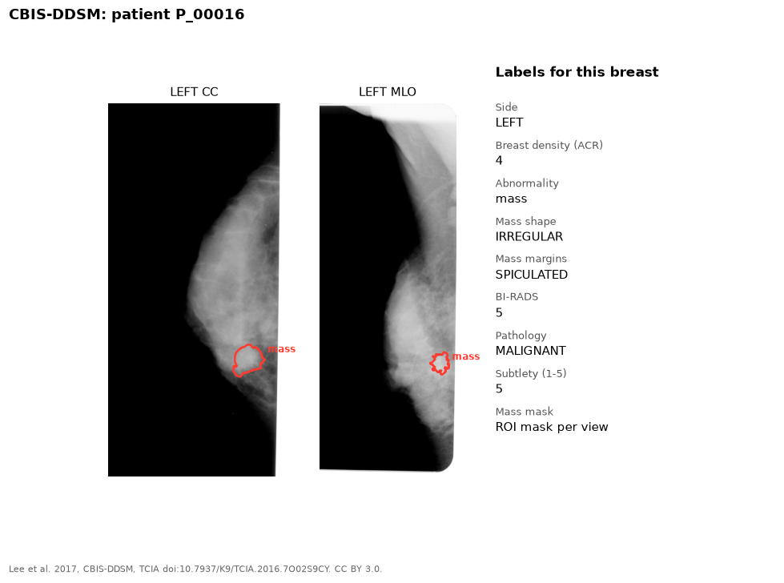

CBIS-DDSM is a curated subset of DDSM, which contains scanned film
mammograms from the USA.

{fig-alt="CC and MLO scanned film mammograms with a red outline around a mass, and the list of labels"}

## Labels

| Label | Level | Notes |
|---|---|---|
| Mass mask | Lesion | Region of interest (ROI) mask, per view |
| Breast density | Breast | ACR 1-4 |
| Mass shape | Lesion | For example irregular, oval, lobulated |
| Mass margins | Lesion | For example spiculated, circumscribed, ill-defined |
| BI-RADS assessment | Lesion | |
| Pathology | Lesion | Benign, benign without callback, or malignant |
| Subtlety | Lesion | 1-5 |

## Our copy

The mass cases only: 1,592 images.

## Source

- Site: [The Cancer Imaging Archive](https://www.cancerimagingarchive.net/collection/cbis-ddsm/)
- Dataset: [doi:10.7937/K9/TCIA.2016.7O02S9CY](https://doi.org/10.7937/K9/TCIA.2016.7O02S9CY)
- Paper: Lee et al. 2017, *Scientific Data*. [doi:10.1038/sdata.2017.177](https://doi.org/10.1038/sdata.2017.177)
- License: CC BY 3.0. Cite the dataset DOI.
