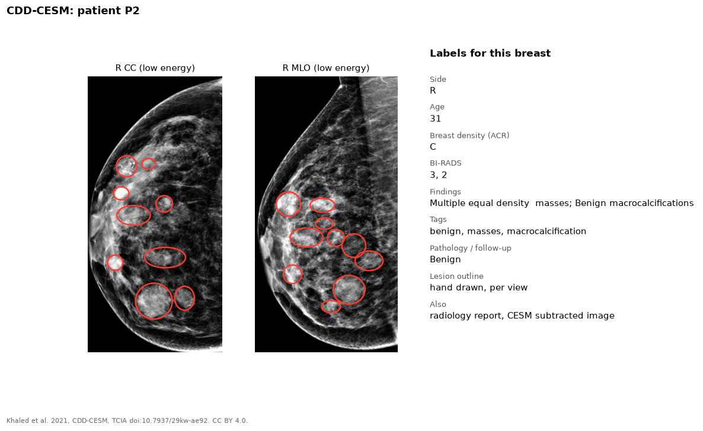

CDD-CESM contains contrast-enhanced spectral mammography from Egypt. Each
exam has a low-energy image, which looks like a standard mammogram, and a
subtracted image.

{fig-alt="Low-energy CC and MLO mammograms with red outlines around many masses, and the list of labels"}

## Labels

| Label | Level | Notes |
|---|---|---|
| Lesion outline | Lesion | Hand drawn, per view. The outlines carry no class |
| Breast density | Image | ACR A-D |
| BI-RADS | Image | One value per finding |
| Findings | Image | Free text, plus tags such as benign, mass, calcification |
| Pathology or follow-up | Image | Normal, benign, or malignant |
| Radiology report | Patient | |

## Our copy

The low-energy images only, because they look like standard mammograms:
1,004 images, with the reports.

## Source

- Site: [The Cancer Imaging Archive](https://www.cancerimagingarchive.net/collection/cdd-cesm/)
- Dataset: Khaled et al. 2021. [doi:10.7937/29kw-ae92](https://doi.org/10.7937/29kw-ae92)
- Paper: Khaled et al. 2022, *Scientific Data*. [doi:10.1038/s41597-022-01238-0](https://doi.org/10.1038/s41597-022-01238-0)
- License: CC BY 4.0. Cite the dataset DOI.
