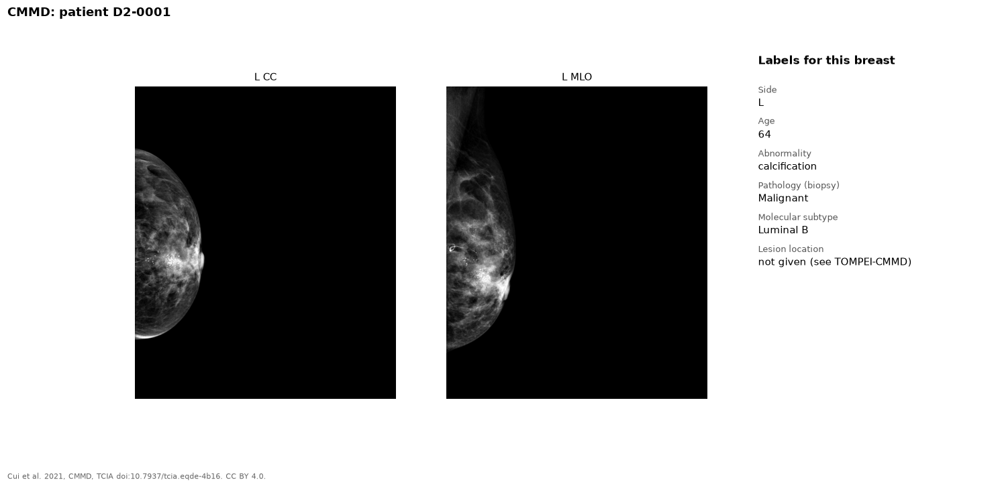

The Chinese Mammography Database contains mammograms from 1,775 patients in
China. Each case is benign or malignant, and some cases have a molecular
subtype.

{fig-alt="CC and MLO mammograms of a left breast, and the list of CMMD labels"}

## Labels

| Label | Level | Notes |
|---|---|---|
| Abnormality | Breast | Calcification, mass, or both |
| Pathology | Breast | Benign or malignant, from biopsy |
| Molecular subtype | Breast | Luminal A, Luminal B, HER2-enriched, triple negative. Some malignant cases only |
| Age | Patient | |

CMMD has no lesion location. [TOMPEI-CMMD](tompei-cmmd.qmd) adds lesion
outlines on the MLO views.

## Our copy

5,202 images, as DICOM.

## Source

- Site: [The Cancer Imaging Archive](https://www.cancerimagingarchive.net/collection/cmmd/)
- Dataset: Cui et al. 2021. [doi:10.7937/tcia.eqde-4b16](https://doi.org/10.7937/tcia.eqde-4b16)
- License: CC BY 4.0. Cite the dataset DOI.
