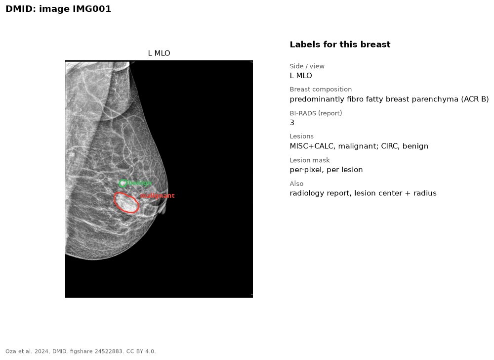

The Digital Mammography Dataset for Breast Cancer Diagnosis Research comes
from India.

{fig-alt="MLO mammogram with a red outline around a malignant lesion and a green outline around a benign lesion, and the list of labels"}

## Labels

| Label | Level | Notes |
|---|---|---|
| Lesion mask | Lesion | Per-pixel annotation of each abnormal region |
| Lesion class | Lesion | Abnormality type (for example circumscribed mass, calcification) and benign or malignant |
| Lesion center and radius | Lesion | Pixel coordinates of the center, and the radius of a circle that encloses it |
| Background tissue | Image | Fatty, glandular, or dense |
| Breast composition | Image | ACR A-D, from the report |
| BI-RADS | Image | From the report |
| Radiology report | Image | |

## Our copy

510 images.

## Source

- Site: [figshare](https://doi.org/10.6084/m9.figshare.24522883)
- Paper: Oza et al. 2024, *Biomedical Engineering Letters*. [doi:10.1007/s13534-023-00339-y](https://doi.org/10.1007/s13534-023-00339-y)
- License: CC BY 4.0, for research and education.
