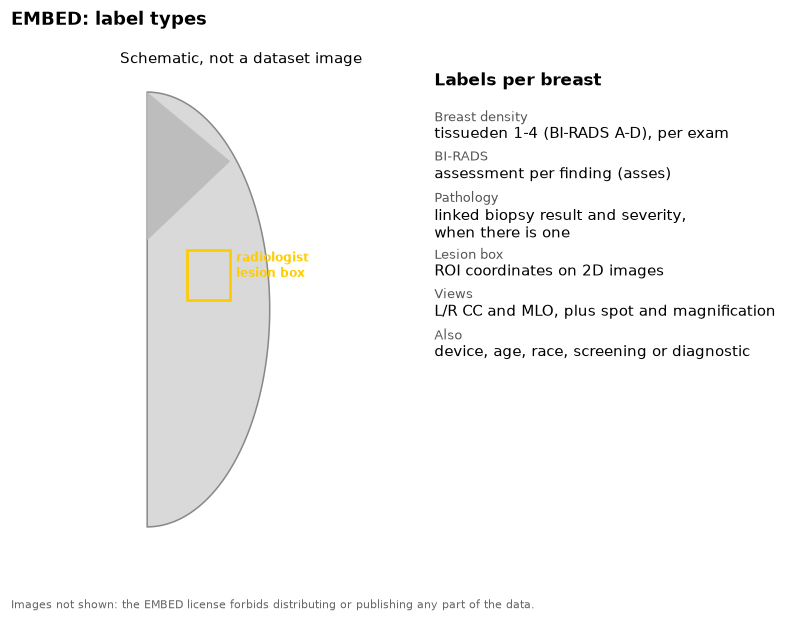

The Emory Breast Imaging Dataset contains real screening and diagnostic
mammograms from Emory University, USA.

{fig-alt="Schematic breast outline with a radiologist lesion box, and the list of EMBED labels"}

## Labels

| Label | Level | Notes |
|---|---|---|
| Breast density | Exam | `tissueden`, 1-4 (BI-RADS A-D) |
| BI-RADS assessment | Finding | `asses` |
| Pathology | Finding | Linked biopsy result and severity (`path_severity`), when there is one |
| Lesion box | Image | `ROI_coords` on 2D images, drawn by a radiologist |
| Demographics | Patient | Age, race, ethnicity |
| Acquisition | Image | Device, view, screening or diagnostic exam |

## Our copy

We have a subset of the open release, because the full release is 2.4 TiB.
The subset has two parts:

- Screening exams with the 4 standard views, from one Hologic device model,
  with one exam for each patient. Each BI-RADS density has up to 1,500
  exams.
- All 2D images that have a radiologist lesion box.

27,438 images in all, stored as lossless DICOM.

## Source

- Site: [AWS Open Data Registry](https://registry.opendata.aws/emory-breast-imaging-dataset-embed/), [EMBED_Open_Data on GitHub](https://github.com/Emory-HITI/EMBED_Open_Data)
- Paper: Jeong et al. 2023, *Radiology: Artificial Intelligence*. [doi:10.1148/ryai.220047](https://doi.org/10.1148/ryai.220047)
- License: custom data use agreement. Each user must register. Do not share the data, the download link, or images from it.
