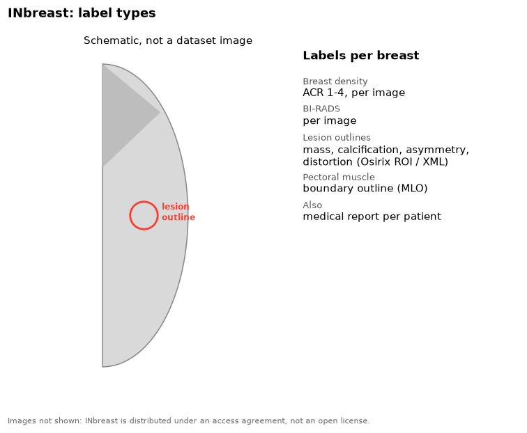

INbreast contains full-field digital mammograms from Porto, Portugal.

{fig-alt="Schematic breast outline with a lesion outline, and the list of INbreast labels"}

## Labels

| Label | Level | Notes |
|---|---|---|
| Breast density | Image | ACR 1-4 |
| BI-RADS | Image | |
| Lesion outlines | Lesion | Mass, calcification, asymmetry, distortion. Osirix ROI and XML files |
| Pectoral muscle | Image | Boundary outline |
| Medical report | Patient | |

## Our copy

412 images, with the outlines and the reports.

## Source

- Site: [INESC TEC repository](https://repositorio.inesctec.pt/items/d20940ac-8e5a-4055-87d5-c32ee4bd774c). The original site, medicalresearch.inescporto.pt/breastresearch, is no longer online.
- Paper: Moreira et al. 2012, *Academic Radiology*. [doi:10.1016/j.acra.2011.09.014](https://doi.org/10.1016/j.acra.2011.09.014)
- License: access agreement with INESC TEC. Do not share the data or images from it.
