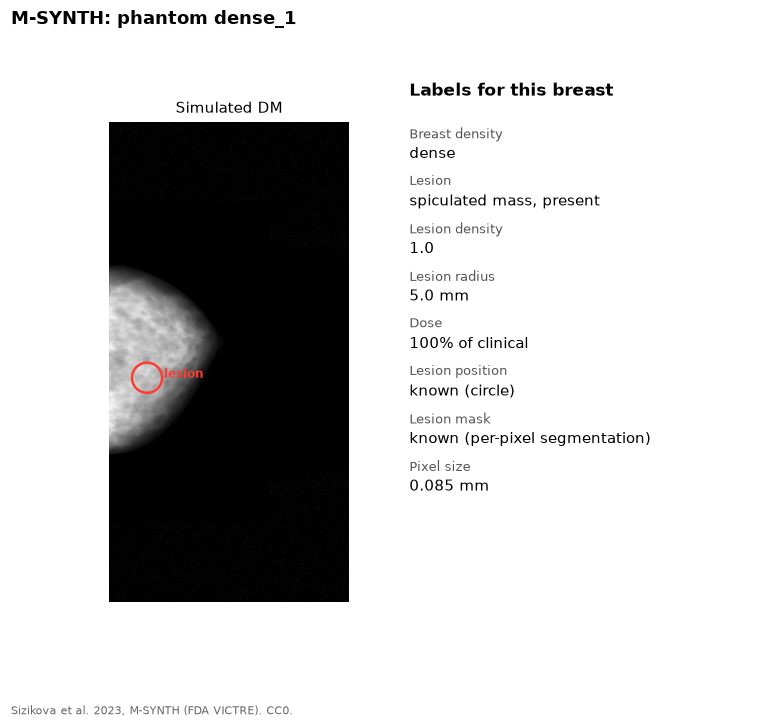

M-SYNTH contains synthetic mammograms that the FDA VICTRE pipeline makes.
Because the images are simulated, the truth is known exactly for every image.

{fig-alt="Simulated mammogram of a dense breast with a red circle around the lesion, and the list of labels"}

## Labels

| Label | Level | Notes |
|---|---|---|
| Breast density | Phantom | Fatty, scattered, heterogeneous, dense |
| Lesion present | Image | Spiculated mass or none |
| Lesion density | Image | For example 1.0, 1.06, 1.1 |
| Lesion radius | Image | For example 5 mm, 7 mm, 9 mm |
| Dose | Image | Percent of the clinical dose |
| Lesion position | Image | Pixel location |
| Lesion mask | Image | Per-pixel segmentation |

## Our copy

14,760 images. A smaller subset gives the stimuli for the AI timing
experiment.

## Source

- Site: [Hugging Face](https://huggingface.co/datasets/didsr/msynth), [msynth-release on GitHub](https://github.com/DIDSR/msynth-release)
- Paper: Sizikova et al. 2023. [arXiv:2310.18494](https://arxiv.org/abs/2310.18494)
- License: CC0
