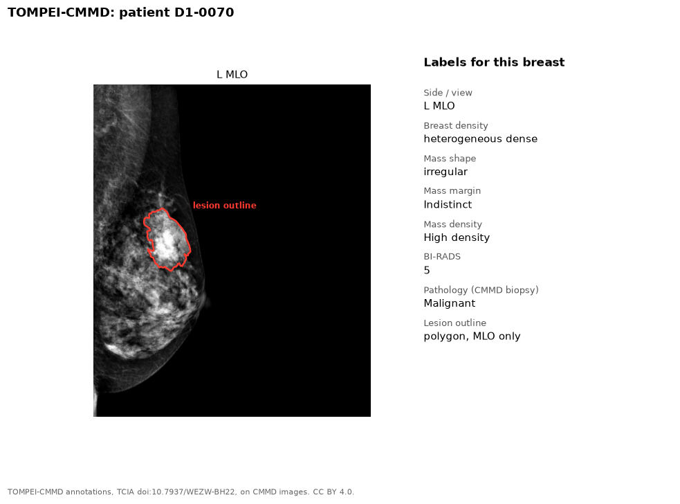

TOMPEI-CMMD is a separate release of expert lesion outlines and imaging
findings for the CMMD images. It also corrects some CMMD laterality and
orientation labels.

{fig-alt="MLO mammogram with a red outline around a mass, and the list of labels"}

## Labels

| Label | Level | Notes |
|---|---|---|
| Lesion outline | Lesion | Polygon, on MLO views only |
| Breast density | Breast | |
| Mass findings | Lesion | Location, shape, margin, density, associated findings |
| Calcification findings | Lesion | Location, morphology, distribution |
| BI-RADS | Breast | |
| Pathology | Breast | Benign or malignant, from CMMD |

## Our copy

1,385 annotation files. The images are our local [CMMD](cmmd.qmd) DICOMs.

## Source

- Site: [The Cancer Imaging Archive](https://www.cancerimagingarchive.net/analysis-result/tompei-cmmd/)
- Dataset: [doi:10.7937/WEZW-BH22](https://doi.org/10.7937/WEZW-BH22)
- License: CC BY 4.0. Cite the dataset DOI.
