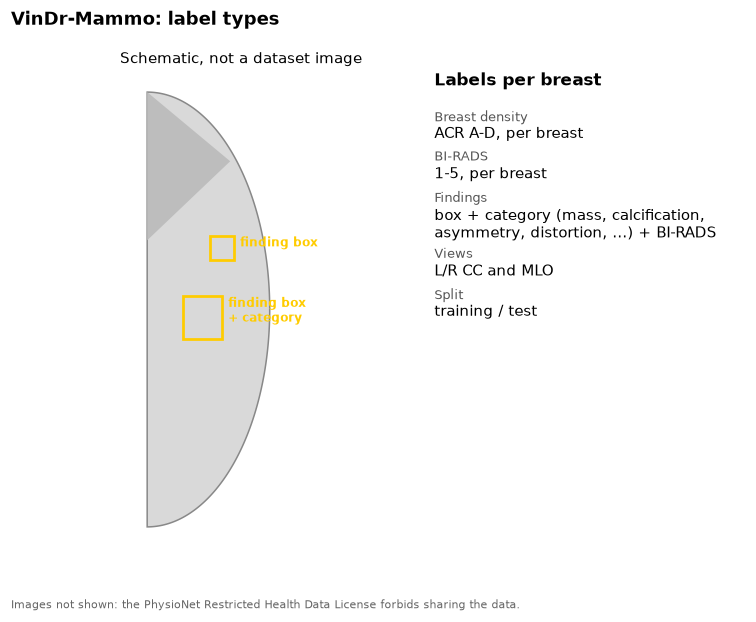

VinDr-Mammo contains 5,000 four-view full-field digital mammography exams
from two hospitals in Vietnam.

{fig-alt="Schematic breast outline with two finding boxes, and the list of VinDr-Mammo labels"}

## Labels

| Label | Level | Notes |
|---|---|---|
| Breast density | Breast | ACR A-D |
| BI-RADS | Breast | 1-5 |
| Findings | Finding | Box, category, and BI-RADS. Categories include mass, suspicious calcification, asymmetry, architectural distortion |
| Split | Exam | Training or test |

## Our copy

20,000 images, as lossless DICOM. The images come from Siemens, Planmed
and IMS devices.

## Source

- Site: [PhysioNet](https://physionet.org/content/vindr-mammo/1.0.0/)
- Paper: Nguyen et al. 2023, *Scientific Data*. [doi:10.1038/s41597-023-02100-7](https://doi.org/10.1038/s41597-023-02100-7)
- License: PhysioNet Restricted Health Data License 1.5.0. Access needs a PhysioNet account; do not share the data.
